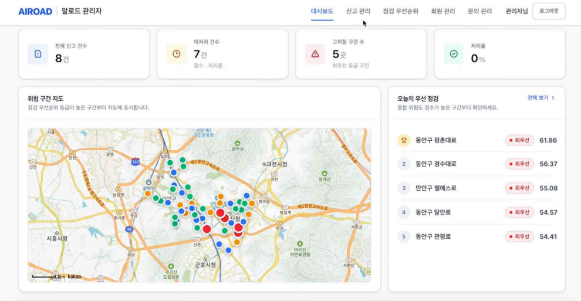
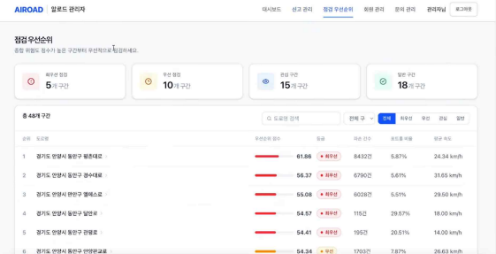
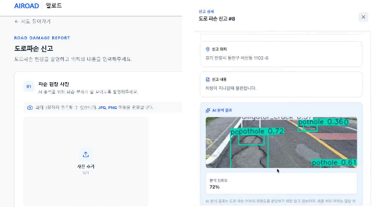
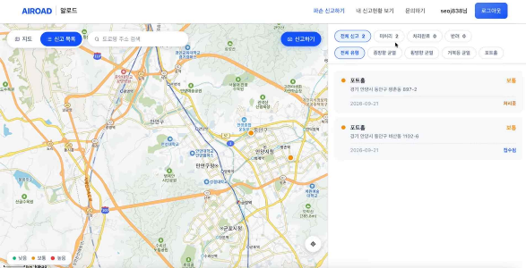

# 안양시 도로 파손 신고 플랫폼 (Back-End)

시민이 도로 파손을 사진으로 신고하면 AI가 파손 여부를 판별하고,
데이터 분석으로 산출한 구역별 점검 우선순위와 연결해 관리자가 점검 순서를 정할 수 있도록 돕는 서비스의 백엔드 서버입니다.

## 개요

| 항목 | 내용 |
| --- | --- |
| 기간 | 2026.09 ~ 2026.09 (약 2주) |
| 인원 | 총 4명 (홍다은, 이나연, 조혜인, 서지연) |
| 담당 | 기여도 약 45%<br>- 인증/보안 (JWT, Spring Security, 자체 로그인, Google/Naver 소셜 로그인)<br>- 계정 상태에 따른 접근 제어 (이용 제한 계정 차단)<br>- 문의 (등록/수정/삭제/조회, 관리자 답변, S3 파일 첨부)<br>- 설정 및 문서화 (민감정보 환경 변수 분리, Swagger 설정) |

## 기술 스택

| 분류 | 기술 |
| --- | --- |
| Language | Java 21 |
| Framework | Spring Boot 4.1, Spring Data JPA, Spring Security, OAuth2 Client |
| Database | MySQL, Flyway |
| Auth | JWT (jjwt), Google/Naver OAuth2 |
| Storage | AWS S3 |
| AI 연동 | FastAPI 기반 YOLO 도로 파손 탐지 서버 |
| Docs | Swagger (springdoc-openapi) |
| Build / Tool | Gradle, IntelliJ IDEA, Git, GitHub |

## 주요 기능

- 회원가입/로그인: 이메일 회원가입, Google/Naver 소셜 로그인, JWT 인증
- 도로 파손 신고: 사진과 위치로 신고 접수, 사진은 S3에 저장
- AI 파손 판별: 신고 사진을 YOLO 서버로 분석해 파손 유형과 개수 저장
- 점검 우선순위: 파손 데이터와 교통 데이터로 산출한 구역별 우선순위에 신고를 연결
- 문의: 문의 등록과 파일 첨부, 관리자 답변
- 관리자: 전체 신고 조회와 처리 상태 변경, 회원 조회와 이용 제한

## 프로젝트 구조

```
anyang/src/main/java/com/dongyang/anyang
├── auth          회원가입, 로그인, JWT 발급
│   └── oauth     Google/Naver 소셜 로그인
├── security      Spring Security 설정, JWT 인증 필터
├── config        CORS, S3, AI 서버, Swagger 설정
├── s3            S3 파일 업로드
└── domain
    ├── user          회원, 이용 상태 관리
    ├── report        도로 파손 신고
    ├── image         신고 이미지
    ├── ai            AI 분석 결과, 탐지 객체
    ├── inspection    구역별 점검 우선순위
    └── inquiry       문의, 첨부 파일
```

## 데이터베이스

```
users ─┬─ reports ─┬─ report_images ── ai_analyses ── ai_detections
       │           └─ inspection_clusters
       └─ inquiries ── inquiry_files
```

| 테이블 | 설명 |
| --- | --- |
| users | 회원 정보, 로그인 방식(자체/Google/Naver), 역할, 이용 상태 |
| reports | 도로 파손 신고 (위치, 내용, 처리 상태, 점검 구역) |
| report_images | 신고 이미지 (S3 URL) |
| ai_analyses, ai_detections | AI 분석 결과, 탐지된 파손 유형과 신뢰도 |
| inspection_clusters | 구역별 파손/교통 지표와 점검 우선순위 (Flyway로 초기 데이터 관리) |
| inquiries, inquiry_files | 문의, 관리자 답변, 첨부 파일 (S3 URL) |

## 담당 업무

### 1. 인증/보안

세션 없이 JWT로 인증하는 구조를 만들고, 자체 로그인과 소셜 로그인이 같은 방식으로 동작하도록 구현했습니다.

```
자체 로그인 ─────────────┐
Google/Naver 소셜 로그인 ─┴→ JWT 발급 → 요청마다 JwtAuthenticationFilter에서 검증 → SecurityContext 등록
```

- `JwtProvider`로 토큰 생성/검증, `JwtAuthenticationFilter`로 요청 헤더의 토큰을 검증해 인증 정보 등록
- `SecurityConfig`에서 세션을 사용하지 않도록(STATELESS) 설정하고, URL별 접근 권한 정의 (관리자 API는 ADMIN만 접근)
- 이메일 회원가입/로그인, BCrypt 비밀번호 암호화, 지정된 관리자 이메일은 가입 시 ADMIN 권한 부여
- Google/Naver가 주는 사용자 정보 형식이 달라 `OAuth2UserInfo` 인터페이스로 추상화하고, 기존 회원은 조회, 신규 회원은 자동 가입
- 소셜 로그인 성공 시 JWT를 발급해 프론트엔드로 리다이렉트
- 인증 실패와 `/error` 경로를 401 JSON 응답으로 처리해 프론트엔드가 일관되게 처리할 수 있도록 함

### 2. 이용 제한 계정 차단

관리자가 이용을 제한한(SUSPENDED) 계정이 서비스를 쓸 수 없도록 세 단계에서 막았습니다.

- 자체 로그인: 로그인 시 403과 안내 메시지 반환
- 소셜 로그인: 인증 실패 핸들러에서 프론트엔드로 에러 정보와 함께 리다이렉트
- JWT 인증 필터: 이미 토큰을 발급받은 상태에서 제한되더라도 이후 요청은 인증되지 않도록 처리

### 3. 문의

- 문의 등록/수정/삭제/목록/상세 조회 API, 관리자 답변 API (`@PreAuthorize`로 관리자만 허용)
- 문의 첨부 파일을 S3에 업로드하고 URL을 저장
- 일반 사용자는 본인 문의만, 관리자는 전체 문의를 조회하도록 구분하고, 권한 없음은 403, 존재하지 않는 문의는 404로 응답

### 4. 설정 및 문서화

- DB 계정, JWT 비밀키, OAuth 키 등 `application.yaml`의 민감정보를 환경 변수로 분리
- Swagger(OpenAPI) 설정과 JWT 인증 버튼 추가로 프론트엔드와 API 명세 공유
- 신고 API를 인증 필수로 변경하고, 응답의 enum 값 형식을 요청/DB와 일치시켜 프론트엔드 연동 오류 해결

## 시연 영상

[](https://www.youtube.com/watch?v=93CyoxzQWAk)

## 화면

| 관리자 대시보드 | 점검 우선순위 |
| --- | --- |
|  |  |

| 도로 파손 신고와 AI 분석 결과 | 시민 신고 지도 |
| --- | --- |
|  |  |

## 트러블슈팅

### 1. 소셜 로그인 신규 가입이 실패하는 문제

- 문제: 소셜 로그인으로 처음 가입하는 사용자는 회원 정보 저장에 실패했습니다.
- 원인: 소셜 로그인 회원은 비밀번호가 없어 null로 저장하고 있었는데, `password` 컬럼이 NOT NULL이라 제약 위반이 발생했습니다. 이를 해결하려고 OAuth 서비스에서 `PasswordEncoder`를 주입받으면, `PasswordEncoder` 빈이 정의된 `SecurityConfig`가 다시 OAuth 서비스를 주입받고 있어 서로를 참조하는 순환 참조 문제가 생기는 구조였습니다.
- 해결: 소셜 로그인 회원에게는 임의의 UUID를 암호화한 값을 비밀번호로 저장해, 제약 조건을 지키면서 비밀번호 로그인은 불가능하도록 했습니다. `PasswordEncoder` 빈은 별도 설정 클래스(`PasswordEncoderConfig`)로 분리해 순환 참조를 없앴습니다.

### 2. 이용 제한 계정이 계속 서비스를 이용할 수 있는 문제

- 문제: 관리자가 계정을 이용 제한해도 해당 사용자가 계속 로그인하고 API를 사용할 수 있었습니다.
- 원인: 계정 상태 값은 저장되지만 로그인과 인증 과정에서 이 값을 확인하지 않았습니다. 특히 JWT는 서버에 상태가 없어, 이미 발급된 토큰은 만료 전까지 계속 유효했습니다.
- 해결: 자체 로그인, 소셜 로그인, JWT 인증 필터 세 곳에서 계정 상태를 확인하도록 했습니다. 필터에서 매 요청 DB의 회원 상태를 확인하기 때문에, 토큰을 이미 가진 사용자도 제한 즉시 차단됩니다.

### 3. 존재하지 않는 문의에 접근하면 500 에러가 발생하는 문제

- 문제: 삭제되었거나 존재하지 않는 문의를 조회/수정/삭제하면 서버 에러(500)가 반환되어, 프론트엔드에서 원인을 구분할 수 없었습니다.
- 원인: 서비스에서 던진 예외를 컨트롤러에서 처리하지 않아 서버 에러로 응답되었습니다.
- 해결: 존재하지 않는 문의는 404, 권한이 없는 접근은 403으로 구분해 응답하도록 수정했습니다.

### 4. Spring Boot 4 환경에서 Swagger가 동작하지 않는 문제

- 문제: Swagger를 설정했지만 Spring Boot 4 환경에서 정상적으로 동작하지 않았습니다.
- 원인: 사용하던 springdoc-openapi 2.x 버전은 Spring Boot 3 기준이라 Spring Boot 4와 호환되지 않았습니다.
- 해결: Spring Boot 4를 지원하는 springdoc-openapi 3.1.1로 업그레이드했습니다.

## 실행 방법

1. MySQL에 `anyangproj` 데이터베이스 생성 (테이블 초기 데이터는 Flyway가 적용)
2. 환경 변수 설정

```
DB_USERNAME, PASSWORD (DB 비밀번호)
JWT_SECRET
GOOGLE_CLIENT_ID, GOOGLE_CLIENT_SECRET
NAVER_CLIENT_ID, NAVER_CLIENT_SECRET
AWS_ACCESS_KEY, AWS_SECRET_KEY
ADMIN_EMAILS
```

3. 실행

```bash
cd anyang
./gradlew bootRun
```

4. API 문서: http://localhost:8085/swagger-ui/index.html

## 회고

- JWT 기반 인증을 직접 구성하며, 서버가 상태를 갖지 않는 구조의 장점과 함께 발급된 토큰을 즉시 무효화하기 어렵다는 한계를 경험했고, 이를 필터 단계의 상태 확인으로 보완했습니다.
- 자체 로그인과 두 가지 소셜 로그인을 하나의 회원 구조로 통합하면서, 공급자마다 다른 데이터 형식을 인터페이스로 추상화하는 방법을 익혔습니다.
- 프론트엔드와 연동하며 에러 상황을 상태 코드로 정확히 구분해 주는 것이 협업 효율에 큰 영향을 준다는 것을 느꼈습니다.
- 아쉬운 점은 예외 처리를 컨트롤러마다 `try-catch`로 처리한 것입니다. 다음에는 `@RestControllerAdvice`로 전역 예외 처리를 적용해 중복을 줄이고 싶습니다.
